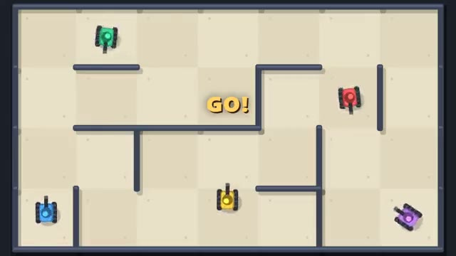

# Ricochet Tanks

Bank shots in a maze. Watch out for your own. A multiplayer starter game from [Multiplayer Agent](https://multiplayeragent.com): 2D, versus, 2–6 players, with bots that fill empty seats.

## How it plays

Drive a tiny tank through a new maze every round. Shells bounce off the walls, and they can come back for you. Grab a laser, a triple shot or a shield. Last tank rolling takes the round; first to five wins.

**Controls:** Arrow keys or WASD to drive, Space to fire, or a thumb stick with a Fire button.

## Make it yours in the Game Builder

Open the [Game Builder](https://multiplayeragent.com), choose **Start from a starter game** and pick Ricochet Tanks. It opens as version 1 in your studio, ready to play and publish. Then ask for changes, for example:

- Add a mine you can drop behind your tank
- Make the maze bigger, with more players
- Give shells a trail of fire and a louder bang

## Run it yourself

1. Get a free publishable key (`pk_…`) at [multiplayeragent.com](https://multiplayeragent.com).
2. In `index.html`, put it in place of `pk_REPLACE_ME` in the `MP_CONNECT` block.
3. Open `index.html` in a browser. No build step and no server needed.

Without a key it still runs, offline against bots.

## How it is built

- One `index.html`. The comment at the top of the script maps the code and explains the multiplayer.
- **Leaderboard:** The players with the most match wins.
- **Host-run rounds:** The host's browser calls each round, keeps score, picks the maze seed and hands out power-ups; if it leaves, the next player takes over.
- **Bots:** Bots fill the empty seats: they find their way through the maze, dodge shells and sometimes bank a shot off the walls.
- **Live sync:** Every tank and every bouncing shell shows up on all screens at once.
- `?attract` runs it offline with bots only. The preview video is recorded from it.

## License

MIT.
